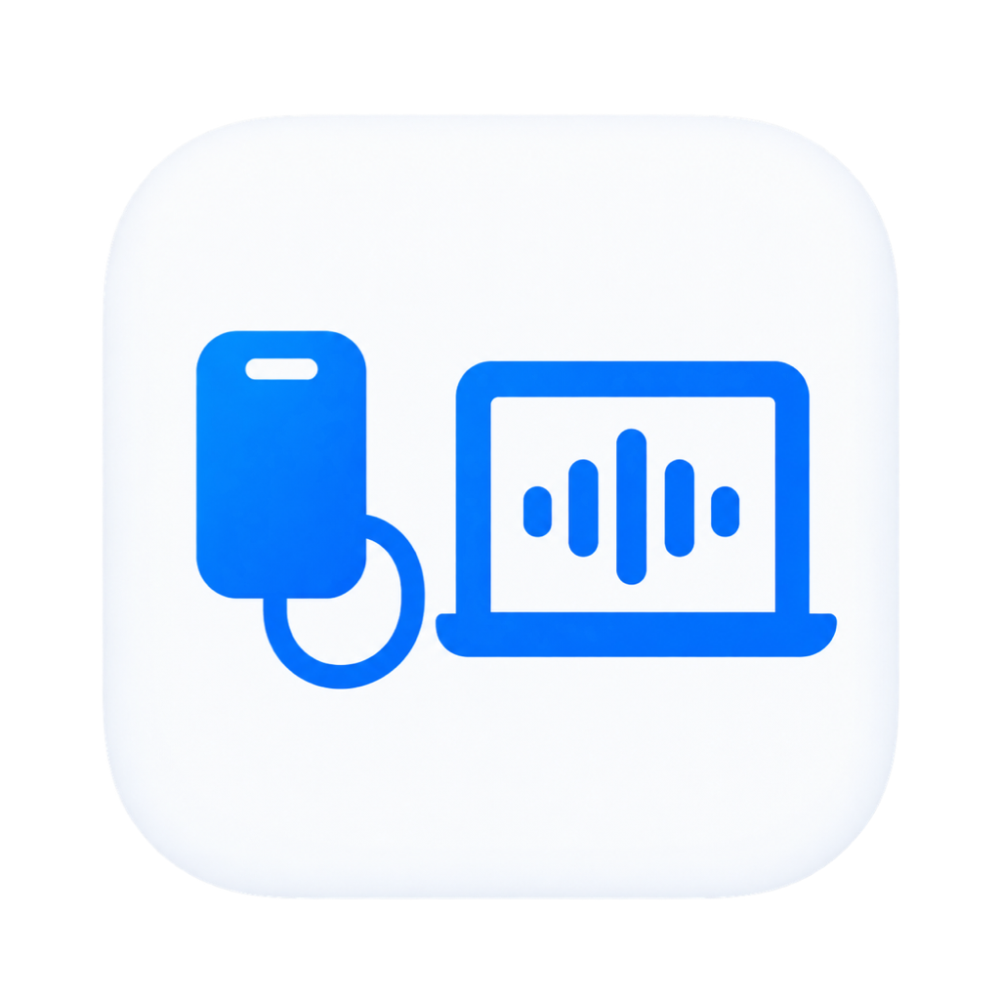

  

<h1 align="center">USB LinkMic</h1>

把 Android 手机接成 Mac 的麦克风，让手机和 Mac 通过 USB 共享网络。

  
  
  

  <a href="https://github.com/xxkingstuggle/usblinkmic/releases/latest">下载</a> ·
  <a href="docs/install.md">使用指南</a> ·
  <a href="docs/how-it-works.md">工作原理</a> ·
  <a href="https://github.com/xxkingstuggle/usblinkmic/issues">反馈问题</a>

## 一根线，三种用途

手机已经有麦克风，也有网络。USB LinkMic 把这些能力接到 Mac 上，放进一个原生窗口里。选好设备，点开始，用完停止。

|功能|怎么用|
|---|---|
|手机当麦克风|通过 USB 或 Wi-Fi 传输音频，在 Mac 上试听，也能配合 BlackHole 用于会议、录音和直播。支持增益与静音。|
|手机网络给 Mac|通过 USB NCM 共享手机网络，不必另外开 Wi-Fi 热点。|
|Mac 网络给手机|通过 USB 把 Mac 的网络接给手机，使用 Android 系统 VPN 接口，无需 root。|

Mac 安装包内已包含配套 APK、ADB 和转发运行时，日常使用不需要安装 Xcode、Android Studio 或 Java。

## 快速开始

1. 从 [Releases](https://github.com/xxkingstuggle/usblinkmic/releases/latest) 下载 DMG，将 USB LinkMic 拖入「应用程序」。
2. 用数据线连接 Android 手机，打开 USB 调试，允许手机上的电脑信任请求。
3. 打开 USB LinkMic，选中手机，在需要的功能页点「开始」。应用会检查配套 Android App，并在需要时引导安装或升级。

第一次使用麦克风需要允许录音权限；第一次使用 Mac 给手机供网需要允许系统 VPN 请求。

想先试声音，可以选「手机麦克风」和「本机试听」，戴上耳机，对着手机说话。要让会议或录音软件收到声音，再按[虚拟麦克风设置](docs/install.md#给会议录音和直播软件使用)配置 BlackHole。

## 支持范围

|项目|要求|
|---|---|
|Mac|macOS 26 及以上，Apple Silicon|
|Android 音频与反向供网|Android 8.0 及以上|
|手机给 Mac 自动共享网络|Android 11 及以上，需要 ROM 支持 USB NCM 和系统网络共享|
|USB 连接|支持数据传输的线缆，已启用 USB 调试|
|Wi-Fi 音频|两端在同一可信局域网|
|外部软件的麦克风输入|另行安装 [BlackHole](https://github.com/ExistentialAudio/BlackHole)|

不同手机系统对 USB 网络共享的支持有所差异。两个供网方向一次只能开启一个，切换前先停止当前任务。Wi-Fi 音频未加密，请在可信网络中使用。

首次打开 Mac 应用遇到系统提示，可查看[安装说明](docs/install.md#安装)。

## 遇到问题

请到 [Issues](https://github.com/xxkingstuggle/usblinkmic/issues) 留下手机型号、系统版本、应用版本和复现步骤，附上「日志」页导出的记录。发送前检查日志，删去不想公开的设备、地址和其他个人信息。

连接、声音输出和网络出口的常见问题见[使用指南](docs/install.md#常见问题)。

## 开发与贡献

欢迎提交问题、改进建议和 Pull Request。修复兼容性问题时，请写清设备型号、系统版本和实际操作步骤。

[构建指南](docs/development.md) · [接口约定](contracts/README.md) · [工作原理](docs/how-it-works.md) · [第三方依赖与许可](docs/dependencies.md)

音频路由使用 BlackHole，USB 反向供网使用 [Gnirehtet](https://github.com/Genymobile/gnirehtet) 的转发组件。感谢这些项目提供的基础能力。
